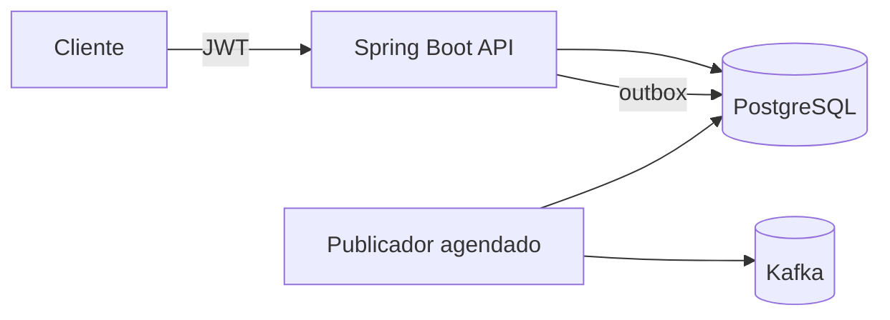

## Contexto

Bruno terminou um projeto de API bancária e começou a se candidatar. Em três semanas, nenhuma resposta. Um amigo que é tech lead abriu o repositório e disse: "o código até é bom, mas o README trabalha contra você". Este é o README:

```markdown
# banco-api

Projeto de estudos.

## Tecnologias
Java, Spring, Spring Boot, Spring Security, JPA, Hibernate,
PostgreSQL, MySQL, MongoDB, Redis, Kafka, RabbitMQ, Docker,
Kubernetes, AWS, Microsserviços, Clean Architecture, DDD,
TDD, SOLID, Design Patterns, CI/CD

## Como rodar
Precisa ter o Postgres instalado. Crie o banco e rode a aplicação.
Configure o application.properties com seu usuário e senha
(o meu está lá: postgres / admin123).

## Endpoints
POST /contas
GET /contas/{id}
POST /transferencias
GET /extrato/{id}

## Observações
Ainda falta fazer os testes. Feito seguindo o curso do canal X.
```

O que se sabe do projeto, pelo código:

- Spring Boot 4, Java 25, PostgreSQL com Flyway.
- Transferência entre contas com lock otimista e nova tentativa; existe um teste que dispara 50 transferências simultâneas e confere que o saldo nunca fica negativo.
- Autenticação com JWT; um cliente só acessa a própria conta (há um teste para isso).
- Eventos de transferência gravados numa tabela de outbox e publicados no Kafka por um agendador.
- 64 testes (unidade e integração com Testcontainers), rodando no GitHub Actions a cada push.
- `docker compose up` sobe a API, o Postgres e o Kafka, mas o README não menciona.
- Não usa MySQL, MongoDB, Redis, RabbitMQ, Kubernetes nem AWS.

## O que entregar

**1. Diagnóstico.** Liste pelo menos seis problemas do README atual. Para cada um: o que está errado, qual dos dois leitores ele prejudica (recrutador ou tech lead) e qual pergunta ruim ele pode gerar na entrevista.

**2. O README novo.** Reescreva o README com as seções da aula: título e uma frase, o que o projeto demonstra, como rodar, arquitetura, decisões e trade-offs, testes, próximos passos e limitações. Use apenas o que o projeto realmente tem.

**3. Seu projeto.** Aplique o mesmo roteiro ao README do seu Fintech Core (ou do seu projeto âncora) e publique.

## Critérios de aceite

- [ ] O diagnóstico aponta o segredo exposto e diz o que fazer com ele.
- [ ] A seção de tecnologias não afirma nada que o projeto não usa.
- [ ] "Como rodar" funciona com um comando e diz os pré-requisitos.
- [ ] Cada item de "o que o projeto demonstra" aponta onde conferir (classe, teste ou pasta).
- [ ] Há pelo menos duas decisões com o trade-off explicado.
- [ ] O README novo cabe numa leitura de dois minutos até a seção de arquitetura.

<Dicas>
<Dica nivel={1}>
Leia o README duas vezes: primeiro como alguém de RH com dois minutos e sem conhecimento técnico profundo, depois como o tech lead que vai te entrevistar e procura o que perguntar. Anote o que cada um pensa em cada seção.
</Dica>
<Dica nivel={2}>
Pontos para olhar com atenção: a senha no texto (e provavelmente no repositório), a lista de tecnologias que o projeto não usa, "ainda falta fazer os testes" quando existem 64, "seguindo o curso do canal X" sem dizer o que foi além, o `docker compose` esquecido e endpoints listados sem contexto.
</Dica>
<Dica nivel={3}>
Para "o que o projeto demonstra", transforme cada fato da lista do enunciado num item com **o quê + como foi verificado + onde olhar**. Exemplo: "Transferências concorrentes sem saldo negativo: lock otimista com nova tentativa, verificado com 50 transferências simultâneas (`TransferenciaConcorrenteIT`)."
</Dica>
</Dicas>

<Solucao>

### Diagnóstico

| # | Problema | Quem ele prejudica | Pergunta ruim que ele gera |
|---|---|---|---|
| 1 | **Senha no README** (e provavelmente no `application.properties` commitado) | os dois, e a segurança | "Como vocês tratam segredos?" Ainda pior: sinaliza descuido antes de qualquer conversa. |
| 2 | Tecnologias que o projeto **não usa** (MySQL, MongoDB, Redis, RabbitMQ, Kubernetes, AWS, microsserviços) | tech lead | "Onde está o Kubernetes? Como você configurou o Redis?" Você não tem resposta. |
| 3 | "Ainda falta fazer os testes", quando existem 64 e CI | recrutador e tech lead | O leitor de dois minutos conclui que não há testes e fecha a aba. |
| 4 | "Projeto de estudos" e "seguindo o curso do canal X", sem dizer o que foi além | recrutador | "Isso é só o tutorial copiado?" |
| 5 | "Como rodar" exige instalar o Postgres à mão; o `docker compose` não aparece | tech lead | Quem tenta rodar desiste. |
| 6 | Nada sobre **o que é difícil** no projeto (concorrência, outbox, posse de conta) | os dois | A entrevista vai para o que você não fez, e não para o que fez bem. |
| 7 | Endpoints sem contexto, sem OpenAPI e sem exemplos | tech lead | Nenhuma, mas é uma oportunidade perdida. |
| 8 | Nome `banco-api` e uma frase que não dizem para que serve | recrutador | — |

Sobre o item 1: além de corrigir o README, **trate a senha como vazada**. Se ela é usada em algum lugar real, troque-a; tire o valor do `application.properties` (use `${DB_PASSWORD}` e um `.env` fora do Git, ou valores só de desenvolvimento no `compose.yaml`), e ligue o *push protection* do GitHub.

### O README novo

````markdown
# Conta Digital API

API de conta digital com transferências, extrato e eventos, construída
para estudar backend Java no nível exigido em vagas Jr/Pleno.


## O que este projeto demonstra

- **Transferências concorrentes sem saldo negativo**: lock otimista com
  nova tentativa, verificado com 50 transferências simultâneas
  (`TransferenciaConcorrenteIT`).
- **Posse de recurso**: cada cliente só acessa a própria conta, com o id
  vindo do JWT (`ContaControllerIT#naoAcessaContaDeOutroCliente`).
- **Eventos sem perda**: outbox na mesma transação da transferência e
  publicação no Kafka por um agendador (`outbox/`).
- **Testes que rodam no CI**: 64 testes, unidade e integração com
  Testcontainers (PostgreSQL e Kafka reais), a cada push.

## Como rodar

Pré-requisitos: Docker. Para desenvolver, Java 25.

```bash
docker compose up
```

A API sobe em http://localhost:8080 e a documentação OpenAPI em
http://localhost:8080/swagger-ui.html. Há exemplos de requisição em
`requests.http`.

## Arquitetura



Pacotes por funcionalidade: `conta/`, `transferencia/`, `extrato/`,
`outbox/`, `seguranca/`.

## Decisões e trade-offs

- **Lock otimista na transferência** (`@Version`): o conflito é raro e a
  nova tentativa é barata. Com muita disputa pela mesma conta, um lock
  pessimista seria mais previsível. Ver `docs/adr/001-lock-otimista.md`.
- **Outbox em vez de publicar direto no Kafka**: publicar dentro da
  transação pode perder eventos (commit sem publicação) ou publicar
  eventos de transações desfeitas. O custo é a latência do agendador
  (até 1 s) e a entrega "pelo menos uma vez", então o consumidor
  precisa ser idempotente. Ver `docs/adr/002-outbox.md`.
- **Monólito modular**: um só deploy, com pacotes separados por
  funcionalidade. Microsserviços não se justificam neste tamanho.

## Testes

```bash
./mvnw verify
```

Requer Docker (Testcontainers). Cobrem regras de saldo, concorrência,
posse de conta, validação e a publicação do outbox.

## Próximos passos e limitações

- O consumidor dos eventos (notificações) ainda não existe.
- Não há rate limiting nos endpoints de autenticação.
- Métricas e tracing (Micrometer, OpenTelemetry) estão planejados.

Projeto iniciado a partir de um curso; reescrevi o domínio e acrescentei
concorrência, outbox, segurança e os testes de integração.
````

### Por que essa versão funciona

- Os **dois minutos** do recrutador chegam até "O que este projeto demonstra": frase clara, badge verde, quatro provas.
- Os **quinze minutos** do tech lead encontram as decisões com trade-off e o caminho até o código e os testes. As perguntas da entrevista vão para o que você fez bem: lock otimista, outbox, idempotência.
- A seção de limitações antecipa "o que você faria a seguir?" e mostra senso crítico.
- A última linha admite o curso **e** mostra o que foi além: honestidade que conta a favor.
- Nenhuma tecnologia listada que o projeto não usa.

### Avalie o seu README

Peça a alguém de fora da área para ler por dois minutos e contar o que o projeto faz. Depois, peça a um dev para tentar rodar só com o README. Se um dos dois travar, reescreva a parte que travou.

</Solucao>
